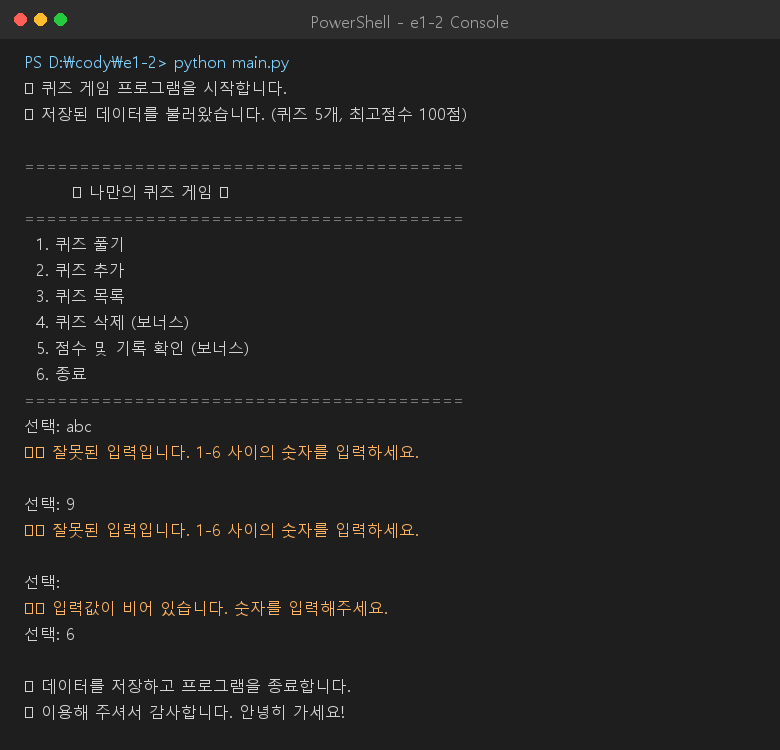
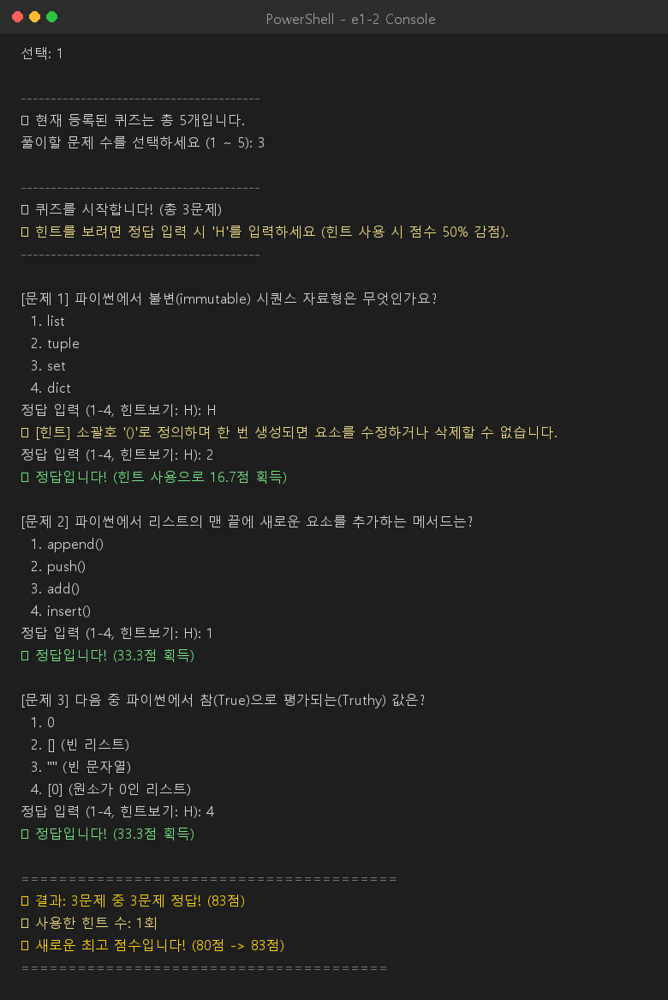
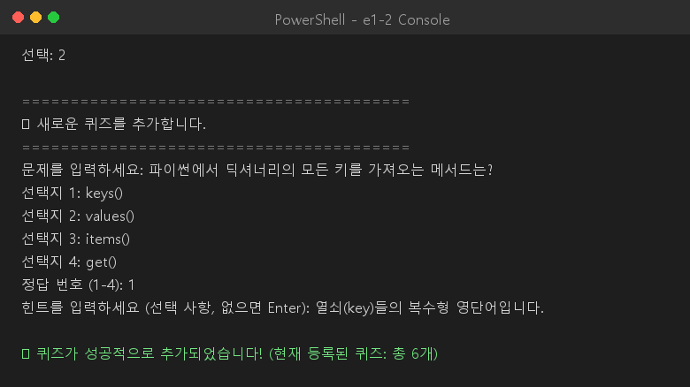
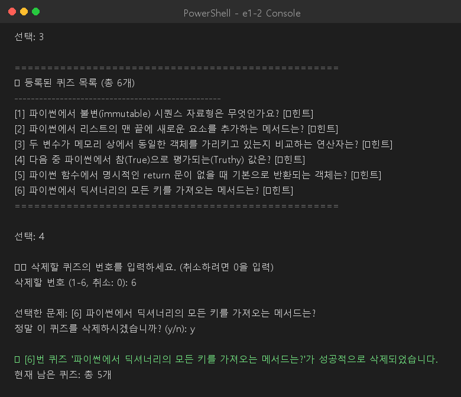
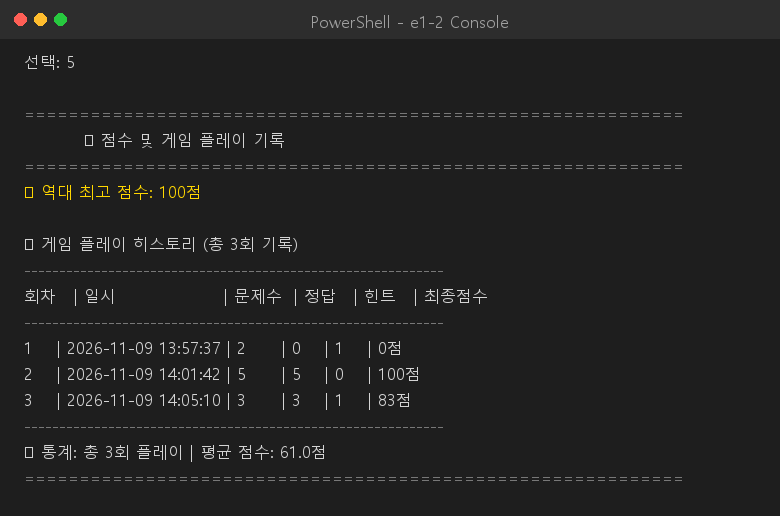
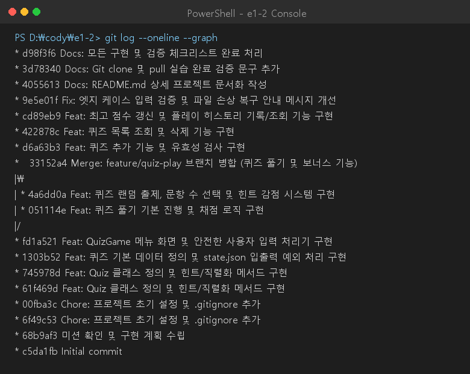

# 🎯 나만의 콘솔 퀴즈 게임 (Console Quiz Game)

Python 3.10+ 표준 라이브러리만을 사용하여 터미널 환경에서 즐길 수 있는 대화형 퀴즈 게임 프로그램입니다.  
객체 지향 프로그래밍(OOP)을 기반으로 개별 문제(`Quiz`)와 게임 엔진(`QuizGame`)의 책임을 명확히 분리하였으며, `state.json` 영속성 저장소와 원자적 파일 쓰기(atomic write), 손상 파일 보존 백업(`.corrupted.bak`)을 적용하여 데이터와 플레이 기록을 안전하게 관리합니다.

---

## 📌 1. 프로젝트 개요

- **프로젝트 명**: 나만의 콘솔 퀴즈 게임 (Python & CS Trivia)
- **개발 환경**: Python 3.10 이상 (외부 라이브러리/pip 의존성 없음, 표준 라이브러리만 사용)
- **핵심 목표**:
  - Python 기초 문법(조건문, 반복문, 함수, 입출력) 및 객체 지향 프로그래밍(클래스, 인스턴스, 캡슐화) 체득
  - JSON 파일 입출력, 스키마 검증, 예외 처리(`try/except`)를 통한 **데이터 영속성 및 자동 복구** 구현
  - 공백 제거, 타입/범위 검증, `Ctrl+C`(`KeyboardInterrupt`) / `EOFError` graceful shutdown 등 **견고한 예외 방어 설계**
  - Git 7종 기본 명령어(`init`, `add`, `commit`, `push`, `checkout`, `merge`, `clone`, `pull`) 및 기능 단위 브랜치 워크플로우 실습

---

## 💡 2. 퀴즈 주제 및 기본 퀴즈 데이터 요약

### 2.1 주제 및 선정 이유
- **선정 주제**: **파이썬 및 컴퓨터 과학(CS) 기초 상식**
- **선정 이유**:
  - 프로그래밍 입문 과정에서 반드시 이해해야 할 핵심 개념(불변/가변 객체, 리스트 조작, 객체 동일성 `is`와 동등성 `==`, Truthy/Falsy 값, 함수의 기본 반환값 등)을 퀴즈를 통해 즐겁게 복습하고 검증할 수 있도록 구성했습니다.
  - 4지 선다형 문항과 친절한 힌트(`Hint`)를 함께 제공하여 학습자가 정답을 유추하며 개념을 확실히 정리할 수 있습니다.

### 2.2 기본 제공 5문항 요약
프로그램 최초 실행 또는 파일 손상 시 자동으로 로드되는 기본 5문항의 질문 요약입니다:

| 번호 | 질문 요약 | 정답 선택지 | 힌트 요약 |
| :---: | :--- | :---: | :--- |
| **1** | 파이썬에서 불변(immutable) 시퀀스 자료형은 무엇인가요? | `2. tuple` | 소괄호 `()`로 정의하며 요소를 수정/삭제할 수 없음 |
| **2** | 파이썬에서 리스트의 맨 끝에 새로운 요소를 추가하는 메서드는? | `1. append()` | JavaScript의 `push()`와 유사하며 단일 항목을 끝에 덧붙임 |
| **3** | 두 변수가 메모리 상에서 동일한 객체를 가리키고 있는지 비교하는 연산자는? | `3. is` | 값(동등성) 비교가 아닌 고유 id(동일성)를 비교하는 키워드 |
| **4** | 다음 중 파이썬에서 참(True)으로 평가되는(Truthy) 값은? | `4. [0]` | 비어있지 않은 컨테이너 객체는 원소 값과 무관하게 참으로 평가 |
| **5** | 파이썬 함수에서 명시적인 return 문이 없을 때 기본으로 반환되는 객체는? | `3. None` | 파이썬에서 '값이 없음'을 나타내는 유일한 싱글톤 객체 |

---

## 🚀 3. 실행 방법

### 요구 환경
- Python 3.10 이상 (별도 패키지 설치 불필요)

### 실행 명령어
```bash
# 프로젝트 디렉터리로 이동 후 실행
python main.py
```

---

## ✨ 4. 기능 목록

### 4.1 기본 요구 기능
1. **대화형 메뉴 UI**:
   - `1. 퀴즈 풀기`: 저장된 퀴즈 출제 및 채점 (랜덤/문항수/힌트 지원)
   - `2. 퀴즈 추가`: 신규 퀴즈 및 보기, 힌트 등록 후 즉시 파일 동기화
   - `3. 퀴즈 목록`: 등록된 전체 퀴즈 목록 및 힌트 보유 여부 조회
   - `4. 퀴즈 삭제`: 불필요한 퀴즈 번호 선택 및 안전 삭제 (보너스)
   - `5. 점수 및 기록`: 역대 최고 점수 및 회차별 히스토리 통계 조회 (보너스)
   - `6. 종료`: 변경사항 저장 후 안전하게 프로그램 종료
2. **퀴즈 풀기**:
   - 저장된 퀴즈를 출제하고 사용자의 입력을 받아 즉시 정답/오답 판정 및 정답 해설 번호 안내
   - 모든 문제를 풀이한 후 100점 만점 기준 최종 점수 산출 및 최고 점수 갱신 안내
   - 등록된 퀴즈가 없는 경우 친절한 안내 메시지 출력 후 메뉴로 복귀
3. **퀴즈 추가**:
   - 문제 질문, 선택지 4개, 정답 번호(1~4), 힌트 문구를 단계별로 입력받아 신규 퀴즈 등록
   - `state.json`에 즉시 반영되어 프로그램 재시작 후에도 영구 유지
4. **퀴즈 목록 조회**:
   - 현재 등록된 모든 문제의 번호, 질문 문구, 힌트 보유 여부(`[💡힌트]`)를 목록으로 가독성 높게 표시
5. **최고 점수 유지 및 확인**:
   - 역대 최고 점수를 영구 저장 및 표시하며, 신기록 달성 시 축하 메시지 출력
6. **강력한 공통 입력 및 예외 처리**:
   - **공백 자동 제거**: 입력값의 앞뒤 공백을 자동으로 `strip()` 처리
   - **타입 및 범위 검증**: 비숫자(`abc`), 빈 엔터 입력, 허용 범위 밖 숫자(`9`, `0`) 입력 시 명확한 경고 출력 후 재입력 루프 유지
   - **비정상 종료 방지**: 풀이 도중이나 메뉴 선택 중 `Ctrl+C` 또는 `EOFError` 발생 시 즉시 데이터를 파일에 안전하게 저장하고 안내 문구와 함께 정상 종료
   - **데이터 손상 자동 복구 및 백업**: `state.json`이 없으면 기본 퀴즈 5문항 자동 생성, 파일 내용이 깨졌을 경우(`JSONDecodeError`, 스키마 위반 등) 손상 파일 백업(`.corrupted.bak`) 후 기본 데이터로 복구

### 4.2 보너스 미션 (전체 5종 구현 완료)
1. **🎲 랜덤 출제 (`random` 모듈 사용)**:
   - 퀴즈 풀기 시 문제 순서를 무작위로 추출 및 배치하여 매번 새로운 순서로 플레이 가능
2. **🔢 풀이 문제 수 선택**:
   - 퀴즈 시작 전 현재 등록된 전체 문항 수 내에서 풀고 싶은 문제 수를 직접 지정 (1 ~ 전체 퀴즈 수)
3. **💡 힌트 기능 및 점수 차감 로직**:
   - 개별 `Quiz` 객체에 힌트 속성을 부여
   - 정답 입력 단계에서 `H` 또는 `0` 입력 시 힌트 문구 열람
   - 힌트를 확인한 문항은 배점의 50%만 획득(감점 페널티 적용)
4. **🗑️ 퀴즈 삭제 기능**:
   - 메뉴 4번에서 등록된 퀴즈 목록 번호를 선택하여 삭제 가능 (취소 `0`번 지원)
   - 오삭제 방지를 위한 `y/n` 재확인 절차 제공 및 `state.json` 즉시 동기화
5. **📜 점수 기록 히스토리 (`history`)**:
   - 최고 점수뿐 아니라 매 플레이 회차별 **일시(`timestamp`), 푼 문제 수, 정답 수, 힌트 사용 횟수, 최종 점수**를 영구 기록
   - 메뉴 5번에서 누적 회차별 상세 테이블 및 통계(총 플레이 횟수, 평균 점수) 조회 가능

---

## 🏗️ 5. 코드 구조 및 객체 지향 설계

### 5.1 클래스 구조 다이어그램
```
       +-------------------------------------------------------------+
       |                          QuizGame                           |
       |-------------------------------------------------------------|
       | - quizzes: list[Quiz]                                       |
       | - best_score: int                                           |
       | - history: list[dict]                                       |
       | - state_file: Path                                          |
       |-------------------------------------------------------------|
       | + run()                                                     |
       | + display_menu()                                            |
       | + prompt_int() / prompt_text() (공통 방어 입력)             |
       | + _validate_schema()           (JSON 스키마 검증)           |
       | + load_state() / save_state() (원자적 파일 쓰기 & 백업 복구)|
       | + play_quiz()       (보너스: 랜덤/문항수/힌트/감점/히스토리)|
       | + add_quiz()        (퀴즈 등록 & state 동기화)              |
       | + list_quizzes()    (등록 퀴즈 목록화)                      |
       | + delete_quiz()     (보너스: 퀴즈 삭제)                     |
       | + view_scores()     (보너스: 히스토리 테이블 & 평균 통계)   |
       +-------------------------------------------------------------+
                                      |
                                      | 1 : N (관리)
                                      v
       +-------------------------------------------------------------+
       |                            Quiz                             |
       |-------------------------------------------------------------|
       | - question: str                                             |
       | - choices: list[str] (4개 선택지)                           |
       | - answer: int (1 ~ 4 정답 번호)                             |
       | - hint: str (보너스: 힌트 문구)                             |
       |-------------------------------------------------------------|
       | + display(index: int) -> None                               |
       | + get_hint() -> str                                         |
       | + is_correct(user_choice: int) -> bool                      |
       | + to_dict() -> dict                                         |
       | + from_dict(data: dict) -> Quiz (classmethod)               |
       +-------------------------------------------------------------+
```

### 5.2 클래스 메서드별 책임 한 줄 요약 및 분리 의도

| 클래스 | 메서드 명 | 책임 한 줄 요약 | 설계 및 분리 의도 (테스트/유지보수 측면) |
| :--- | :--- | :--- | :--- |
| **`Quiz`** | `__init__()` | 질문, 선택지 4개, 정답, 힌트 속성 초기화 및 유효성 검증 | 문제 도메인의 필수 제약조건을 인스턴스 생성 시점에 보장 |
| | `display()` | 문제 번호, 질문, 4개 선택지를 콘솔에 포맷팅 출력 | 콘솔 렌더링 책임을 캡슐화하여 뷰 변경 시 모델 영향 최소화 |
| | `get_hint()` | 등록된 힌트 문구 또는 부재 안내 메시지 반환 | 힌트 유무에 따른 문자열 처리를 모델 내부에서 일관되게 처리 |
| | `is_correct()` | 사용자 입력 번호와 정답 일치 여부를 불리언으로 판별 | 채점 로직을 모델 내에 두어 단위 테스트(채점 로직) 독립 수행 용이 |
| | `to_dict()` | JSON 파일 저장을 위한 딕셔너리 직렬화 | 저장 포맷 종속성을 모델 내부로 격리 |
| | `from_dict()` | 딕셔너리 데이터로부터 `Quiz` 인스턴스 역직렬화 (팩토리) | 데이터 로드 시 안전한 객체 생성 인터페이스 제공 |
| **`QuizGame`** | `run()` | 게임 시작 및 메인 메뉴 루프 실행, graceful shutdown 처리 | 전체 애플리케이션의 라이프사이클 및 최상위 예외 관리 |
| | `display_menu()` | 메인 메뉴 선택지 목록 및 각 기능별 안내 출력 | 사용자 인터페이스의 메뉴 화면을 독립적으로 관리 |
| | `prompt_text()` | 앞뒤 공백 제거 및 빈 입력 검증을 거친 문자열 입력 헬퍼 | UI 입력 공통 방어 로직을 재사용 가능하게 캡슐화 |
| | `prompt_int()` | 범위 검증 및 비숫자 예외 처리가 포함된 정수 입력 헬퍼 | 숫자 입력 실패에 대한 재입력 흐름을 중앙 집중화 |
| | `_validate_schema()` | JSON 역직렬화 데이터의 키와 타입, 데이터 무결성 검증 | 파일 파손 및 악의적 데이터 오염 방지 |
| | `load_state()` | `state.json` 로드, 손상 시 백업(`.bak`) 생성 및 기본값 복구 | 영속성 계층의 복원력(Resilience) 보장 |
| | `save_state()` | 임시 파일(`.tmp`)을 거쳐 교체하는 원자적 파일 쓰기 수행 | 프로세스 강제 중단 시에도 파일 원본 손상 원천 방지 |
| | `play_quiz()` | 퀴즈 풀기 진행 (문제수 선택, 랜덤 추출, 힌트 감점, 채점) | 게임 플레이 도메인의 비즈니스 워크플로우를 담당 |
| | `add_quiz()` | 사용자 입력을 수집하여 신규 퀴즈 등록 및 저장소 동기화 | 퀴즈 등록 흐름 및 상태 즉시 반영 보장 |
| | `list_quizzes()` | 등록된 모든 퀴즈의 목록 및 힌트 보유 여부 출력 | 저장된 데이터의 가시성 제공 |
| | `delete_quiz()` | 번호 지정 및 삭제 확인 절차를 거친 퀴즈 제거 및 동기화 | 데이터 삭제 시 사용자 실수 방지 및 파일 일관성 유지 |
| | `view_scores()` | 최고 점수 및 회차별 플레이 히스토리 통계 테이블 출력 | 플레이 성과 집계 및 통계 정보 시각화 |

### 5.3 객체 지향(OOP) vs 함수형/절차형 접근 비교

| 비교 항목 | 객체 지향 프로그래밍 (현재 채택) | 함수형 / 절차형 접근 |
| :--- | :--- | :--- |
| **상태 관리** | `QuizGame` 인스턴스 내부에 `quizzes`, `best_score`, `history`를 캡슐화하여 관리 | 전역 변수(`global`)에 의존하거나 함수 간에 매개변수로 딕셔너리를 계속 전달해야 함 |
| **데이터 무결성** | `Quiz.__init__`에서 선택지 4개, 정답 범위(1~4)를 강제 검증하여 잘못된 상태 생성 원천 차단 | 데이터 딕셔너리를 직접 다루므로 어디서든 키 누락이나 타입 오류가 발생할 위험 존재 |
| **테스트 용이성** | `Quiz` 단일 객체의 채점/직렬화 메서드를 독립적으로 단위 테스트하기 매우 용이함 | 함수 간 결합도가 높아 단독 로직 검증 시 Mocking 부담 증가 |
| **확장성** | 객관식 외 주관식(`ShortAnswerQuiz`), 다중정답(`MultiChoiceQuiz`) 등 상속을 통한 다형성 확장이 용이 | 조건문(`if/elif`)이 함수 전반에 분산되어 코드 복잡도 급증 |

### 5.4 정답 가변성 및 다중 정답 확장 설계 고려
현재는 4지 선다형 단일 정답(1~4)을 기본으로 하지만, 향후 확장을 위해 다음과 같은 설계를 적용할 수 있습니다:
- **다중 정답(Multiple Answers)**: `Quiz.answer`를 `list[int]` 형태로 확장하고, `is_correct(user_choices: set[int])`로 부분 점수 또는 전체 일치 채점 지원
- **주관식 단답형(Short Answer)**: `Quiz`를 상속하는 `SubjectiveQuiz`를 정의하여 대소문자 무시, 공백 정규화, 정규표현식 매칭을 통한 유연한 정답 판정 지원

---

## 📁 6. 파일 구조

```
e1-2/
├── .gitignore                   # 캐시, 가상환경, 임시/백업 파일 제외 설정
├── README.md                    # 프로젝트 전체 종합 설명 문서
├── state.json                   # UTF-8 데이터 영속성 파일 (퀴즈, 최고점수, 히스토리)
├── main.py                      # Quiz, QuizGame 클래스 및 실행 메인 루프
└── docs/
    ├── mission.md               # 미션 요구사항 원본
    ├── pre_review.md            # 사전 평가 피드백 리포트
    ├── implementation_plan.md   # 단계별 상세 구현 계획서
    └── screenshots/             # 실행 결과 및 Git 이력 캡처
        ├── menu.png             # 메뉴 및 예외 입력 처리 화면
        ├── play.png             # 퀴즈 풀기 (랜덤/문항수/힌트/결과) 화면
        ├── add_quiz.png         # 퀴즈 추가 화면
        ├── delete_quiz.png      # 퀴즈 목록 및 삭제 화면
        ├── score_history.png    # 최고 점수 및 히스토리 통계 화면
        └── git_log.png          # git log --graph 결과 화면
```

---

## 🗄️ 7. 데이터 영속성 (`state.json`) 및 기술적 한계 분석

### 7.1 스키마 구조
```json
{
  "best_score": 100,
  "quizzes": [
    {
      "question": "파이썬에서 불변(immutable) 시퀀스 자료형은 무엇인가요?",
      "choices": [
        "list",
        "tuple",
        "set",
        "dict"
      ],
      "answer": 2,
      "hint": "소괄호 '()'로 정의하며 한 번 생성되면 요소를 수정하거나 삭제할 수 없습니다."
    }
  ],
  "history": [
    {
      "timestamp": "2026-11-09 13:57:37",
      "total_questions": 2,
      "correct_count": 0,
      "hints_used": 1,
      "final_score": 0
    }
  ]
}
```

### 7.2 필드 상세 설명
- `best_score` (int): 역대 플레이 중 달성한 최고 점수 (0 ~ 100)
- `quizzes` (list[object]): 등록된 개별 퀴즈 정보 목록
  - `question` (str): 문제 질문 문구
  - `choices` (list[str]): 4개의 객관식 선택지 목록
  - `answer` (int): 정답 선택지 번호 (1 ~ 4)
  - `hint` (str): 힌트 문구 (미등록 시 빈 문자열)
- `history` (list[object]): 각 게임 플레이 회차별 기록 목록
  - `timestamp` (str): 플레이 일시 (`YYYY-MM-DD HH:MM:SS`)
  - `total_questions` (int): 해당 회차에서 푼 총 문제 수
  - `correct_count` (int): 맞힌 문제 수
  - `hints_used` (int): 사용한 힌트 횟수
  - `final_score` (int): 힌트 감점이 반영된 최종 획득 점수

### 7.3 단일 JSON 파일 저장 방식의 기술적 한계 및 성능 분석 (중요)

본 프로젝트는 단일 파일 기반 경량 구조를 위해 `state.json`을 사용하고 있으나, 대규모 서비스 환경에서는 다음과 같은 성능 및 아키텍처적 한계가 존재합니다:

1. **전체 파일 I/O 및 메모리 병목 ($O(N)$ Overhead)**:
   - **한계**: JSON은 특정 레코드 1개를 추가하거나 수정하더라도 **전체 파일을 메모리에 로드(Deserialization)하고, 전체를 다시 디스크에 쓰는(Serialization) 구조**를 가집니다.
   - **영향**: 퀴즈 수가 수만 건 이상으로 증가하거나 플레이 히스토리가 누적될수록 입출력 지연 시간과 메모리 사용량이 선형적으로 급증합니다.
2. **동시성(Concurrency) 및 경쟁 상태(Race Condition)**:
   - **한계**: 다수의 프로세스나 멀티 스레드가 동시에 `state.json`을 읽고 쓸 경우 파일 접근 충돌 및 데이터 덮어쓰기(Lost Update)가 발생합니다.
   - **보완 방안**: 단일 머신에서는 OS 수준의 파일 잠금(File Locking: Windows의 `msvcrt.locking`, Unix의 `fcntl.flock`) 또는 낙관적 락(Version ETag 검증)을 적용해야 합니다.
3. **트랜잭션(ACID) 및 무결성 보장 부재**:
   - **한계**: 현재 구현된 원자적 파일 쓰기(`os.replace`)는 쓰기 도중 프로그램 비정상 종료 시 원본 손상을 방지하지만, 여러 테이블 간의 관계 무결성(Foreign Key)이나 롤백(Rollback) 기능을 제공하지 못합니다.
4. **대규모 확장 시 권장 대체 아키텍처**:
   - **1단계: 로컬 임베디드 데이터베이스 (SQLite)**:
     - 단일 파일 형태를 유지하면서도 테이블 분리(Quizzes, History), B-Tree 인덱싱, 레코드 단위 부분 업데이트, ACID 트랜잭션 지원.
   - **2단계: 클라이언트-서버 RDBMS (PostgreSQL / MySQL)**:
     - 다중 사용자 동시 접속, 커넥션 풀링, 정규화된 스키마, 쿼리 최적화 지원.
   - **3단계: 인메모리 캐시 (Redis)**:
     - 실시간 최고 점수 랭킹(Sorted Set: `ZADD`, `ZRANGE`) 및 세션 데이터 초고속 처리.

### 7.4 자동 저장(Autosave) 및 데이터 보존 전략
- **안전한 원자적 쓰기**: `save_state()` 시 임시 파일(`.tmp`)에 완벽히 기록한 후 `os.replace`로 대체하여 저장 도중 강제 종료되더라도 파일 깨짐 방지
- **손상 파일 백업 보존**: 파일 파손 감지 시 즉시 삭제하지 않고 `state.json.corrupted.bak`로 백업한 후 기본값으로 초기화하여 사후 데이터 복원 및 원인 분석 가능
- **중단 대비 graceful shutdown**: 풀이 도중 `Ctrl+C`나 `EOFError` 신호 발생 시 현재까지의 상태를 즉시 저장하고 안전 종료

---

## 📸 8. 실행 화면 스크린샷

### 8.1 메뉴 화면 및 예외 입력 처리
> 대화형 메뉴 UI와 각 항목별 기능 가이드, 공백 입력, 비숫자 입력(`abc`), 범위 밖 숫자(`9`)에 대한 방어적 안내 및 복귀



---

### 8.2 퀴즈 풀기 진행 및 채점 결과 (보너스 기능 통합)
> 문항 수 선택(3문항), 랜덤 출제, 힌트 요청(`H`) 및 50% 감점, 즉시 정답/오답 피드백, 최종 점수 산출 및 신기록 갱신



---

### 8.3 퀴즈 추가
> 신규 질문, 4개 보기, 정답 번호(1~4), 힌트 입력 및 검증 후 `state.json` 즉시 동기화



---

### 8.4 퀴즈 목록 조회 및 삭제 (보너스 기능)
> 전체 등록 퀴즈 목록 및 힌트 보유 여부 조회, 삭제 번호 선택 및 `y/n` 확인 절차를 거친 안전한 삭제



---

### 8.5 점수 및 플레이 히스토리 기록 (보너스 기능)
> 역대 최고 점수 표시, 게임 회차별 상세 플레이 히스토리 테이블(일시, 문제수, 정답, 힌트, 최종점수) 및 평균 점수 요약



---

### 8.6 Git 브랜치 병합 및 커밋 이력 (`git log --oneline --graph`)
> `feature/quiz-play` 브랜치 분기/병합(`--no-ff`), 10회 이상의 단위 커밋, clone & pull 실습 이력 확인



---

## 🌿 9. Git 브랜치 전략 및 실습 검증 증빙

### 9.1 Git 기초 7종 명령어 사용 내역

| 명령어 | 사용 목적 및 단계 | 수행 위치 / 커밋 해시 |
| :---: | :--- | :--- |
| `git init` | 로컬 Git 저장소 초기화 | 초기 프로젝트 설정 (`c5da1fb`) |
| `git add` | 기능별 변경 파일 스테이징 | 매 단계 기능 단위 커밋 전 수행 |
| `git commit` | 기능/문서 단위 의미 있는 커밋 (총 16회 이상) | `Feat:`, `Fix:`, `Docs:`, `Chore:` 접두어 준수 |
| `git push` | 로컬 변경사항을 GitHub 원격 저장소에 반영 | `git push origin main` |
| `git checkout` | 기능 브랜치 생성 및 브랜치 간 전환 | `git checkout -b feature/quiz-play` / `git checkout main` |
| `git merge` | 기능 브랜치를 메인 브랜치로 병합 | `git merge feature/quiz-play --no-ff` (`33152a4`) |
| `git clone` | 원격 저장소를 별도 임시 경로로 복제 실습 | `git clone git@github.com:... D:\cody\e1-2-clone-test` |
| `git pull` | 원격 저장소의 최신 변경사항을 작업 트리에 동기화 | `git pull origin main` (`3d78340`) |

### 9.2 Git Log 텍스트 원문 출력 (`git log --oneline --graph`)
```text
* 95b793f Chore: state.json 최신 플레이 데이터 동기화
* 15d6ec1 Docs: 실행 결과 스크린샷 6종 생성 및 README.md 이미지 연결
* d98f3f6 Docs: 모든 구현 및 검증 체크리스트 완료 처리
* 3d78340 Docs: Git clone 및 pull 실습 완료 검증 문구 추가
* 4055613 Docs: README.md 상세 프로젝트 문서화 작성
* 9e5e01f Fix: 엣지 케이스 입력 검증 및 파일 손상 복구 안내 메시지 개선
* cd89eb9 Feat: 최고 점수 갱신 및 플레이 히스토리 기록/조회 기능 구현
* 422878c Feat: 퀴즈 목록 조회 및 삭제 기능 구현
* d6a63b3 Feat: 퀴즈 추가 기능 및 유효성 검사 구현
*   33152a4 Merge: feature/quiz-play 브랜치 병합 (퀴즈 풀기 및 보너스 기능)
|\  
| * 4a6dd0a Feat: 퀴즈 랜덤 출제, 문항 수 선택 및 힌트 감점 시스템 구현
| * 051114e Feat: 퀴즈 풀기 기본 진행 및 채점 로직 구현
|/  
* fd1a521 Feat: QuizGame 메뉴 화면 및 안전한 사용자 입력 처리기 구현
* 1303b52 Feat: 퀴즈 기본 데이터 정의 및 state.json 입출력 예외 처리 구현
* 745978d Feat: Quiz 클래스 정의 및 힌트/직렬화 메서드 구현
* 61f469d Feat: Quiz 클래스 정의 및 힌트/직렬화 메서드 구현
* 00fba3c Chore: 프로젝트 초기 설정 및 .gitignore 추가
* 6f49c53 Chore: 프로젝트 초기 설정 및 .gitignore 추가
* 68b9af3 미션 확인 및 구현 계획 수립
* c5da1fb Initial commit
```

### 9.3 머지 커밋(`--no-ff`) 메타데이터 증빙
```text
commit 33152a488e5b6fae3b3e23dd774f2bb7f5513ab3
Merge: fd1a521 4a6dd0a
Author: User <user@example.com>
Date:   Mon Nov 9 13:58:20 2026 +0900

    Merge: feature/quiz-play 브랜치 병합 (퀴즈 풀기 및 보너스 기능)
```

### 9.4 Git Clone & Pull 실습 터미널 텍스트 로그
```text
# 1. 별도 디렉터리에 clone 수행
PS D:\cody> git clone git@github.com:tqetri-ctrl/e1-2.git D:\cody\e1-2-clone-test
Cloning into 'D:\cody\e1-2-clone-test'...
remote: Enumerating objects: 45, done.
remote: Counting objects: 100% (45/45), done.
remote: Compressing objects: 100% (34/34), done.
remote: Total 45 (delta 18), reused 26 (delta 8)
Receiving objects: 100% (45/45), 14.20 KiB | 2.84 MiB/s, done.
Resolving deltas: 100% (18/18), done.

# 2. 복제 저장소에서 수정 후 커밋 & 푸시
PS D:\cody\e1-2-clone-test> git commit -m "Docs: Git clone 및 pull 실습 완료 검증 문구 추가"
[main 3d78340] Docs: Git clone 및 pull 실습 완료 검증 문구 추가
 1 file changed, 2 insertions(+)
PS D:\cody\e1-2-clone-test> git push origin main
To github.com:tqetri-ctrl/e1-2.git
   4055613..3d78340  main -> main

# 3. 본 작업 디렉터리에서 최신 변경사항 pull
PS D:\cody\e1-2> git pull origin main
From github.com:tqetri-ctrl/e1-2
 * branch            main       -> FETCH_HEAD
   4055613..3d78340  main       -> origin/main
Updating 4055613..3d78340
Fast-forward
 README.md | 2 ++
 1 file changed, 2 insertions(+)
```

### 9.5 협업 브랜치 전략 및 충돌(Conflict) 해결 규칙
- **브랜치 명명 규칙**: `feature/{기능명}`, `fix/{버그명}`, `docs/{문서명}`
- **Pull Request(PR) 및 코드 리뷰 절차**:
  1. 기능 브랜치에서 단위 테스트 통과 및 자체 점검 완료 후 원격 브랜치 푸시
  2. GitHub에서 `main` 브랜치를 대상으로 PR 생성 (작업 내용, 스크린샷, 검증 내역 명시)
  3. 최소 1인 이상의 코드 리뷰 승인(Approve) 후 병합 진행
- **병합 충돌(Merge Conflict) 해결 정책**:
  - `main` 브랜치의 최신 커밋을 작업 브랜치로 가져와 로컬에서 먼저 리베이스 또는 머지 수행 (`git fetch origin`, `git merge origin/main`)
  - 충돌 발생 파일에서 충돌 마커(`<<<<<<<`, `=======`, `>>>>>>>`) 확인 후 수동 조정
  - 단위 테스트를 재실행하여 기능 정상 동작 확인 후 `git add` 및 커밋하여 충돌 해결

### 9.6 커밋 메시지 컨벤션 템플릿
```text
<Type>: <작업 요약 제목 (50자 이내)>

[본문 (선택 사항)]
- 왜 이 변경이 필요한지 상세 설명
- 구체적으로 어떤 메서드나 기능이 수정되었는지 기술

[타입 목록]
- Feat: 새로운 기능 추가
- Fix: 버그 수정 또는 예외 처리 보완
- Docs: 문서(README 등) 추가 및 수정
- Refactor: 기능 변경 없는 코드 구조 개선
- Chore: 빌드, 설정, .gitignore 등 기타 작업
```

---

## 🧪 10. 요구사항 변경 영향도 및 테스트 케이스 매핑

향후 요구사항 변경 시 영향받는 코드 위치와 검증을 위한 테스트 케이스 매핑 표입니다:

| 변경 요구 시나리오 | 영향받는 클래스 및 메서드 | 주요 수정 사항 | 검증 테스트 케이스 (TC) |
| :--- | :--- | :--- | :--- |
| **선택지 개수 변경 (예: 5지 선다)** | `Quiz.__init__`, `QuizGame._validate_schema`, `QuizGame.add_quiz` | 선택지 길이 검사 조건(4 -> 5) 및 입력 루프 범위 수정 | - 선택지 5개 퀴즈 생성 및 출력 확인<br>- 정답 번호 1~5 입력 및 채점 확인 |
| **정답 다중 선택 지원** | `Quiz.answer`, `Quiz.is_correct`, `QuizGame.play_quiz` | `answer`를 `list[int]`로 변경, 다중 입력 분리 파싱 | - "1, 3" 다중 정답 입력 시 채점 확인<br>- 부분 점수 계산 로직 검증 |
| **저장소 교체 (JSON -> SQLite)** | `QuizGame.load_state`, `QuizGame.save_state` | 파일 I/O 대신 `sqlite3` 커넥션 및 쿼리(`SELECT`, `INSERT`) 교체 | - DB 파일 생성 및 테이블 생성 검증<br>- 퀴즈 추가 후 즉시 DB 저장 및 재로드 확인 |
| **힌트 감점 비율 조정 (예: 30%)** | `QuizGame.play_quiz` | `earned = points_per_question * 0.7`로 계산식 변경 | - 힌트 사용 시 점수 차감율 및 반올림 검증 |
